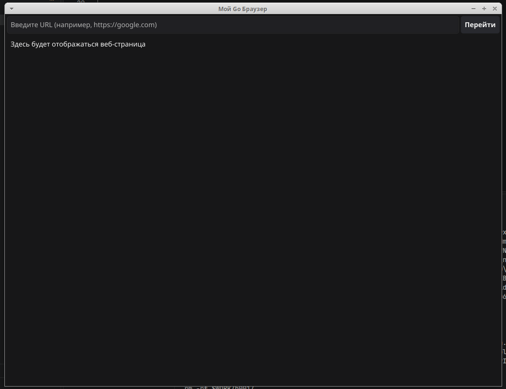

# Go Browser (Мой Go Браузер)

Простой веб-браузер, написанный на языке Go с использованием графической библиотеки **Fyne v2**.



## 🛠 Системные требования (для Linux / Ubuntu)

Перед компиляцией проекта в системе должны быть установлены необходимые графические библиотеки для разработки (OpenGL, X11, Wayland):

```bash
sudo apt update && sudo apt install -y golang gcc libgl1-mesa-dev xorg-dev libwayland-dev libxkbcommon-dev
```

## 🚀 Установка и первый запуск

1. Инициализация Go-модуля (если проект создается с нуля):
   ```bash
   go mod init my_browser
   ```

2. Загрузка графической библиотеки Fyne:
   ```bash
   go get fyne.io/fyne/v2
   ```

3. **Сборка проекта:**
   Из-за большого объема генерируемого C-кода в связке Go 1.26+ и OpenGL, первую сборку необходимо запускать с отключением оптимизаций, чтобы избежать зависания компилятора:
   ```bash
   GOGC=off CGO_CFLAGS="-O0 -w" go build main.go
   ```

4. **Запуск скомпилированного приложения:**
   ```bash
   ./main
   ```
   *(Примечание: Все последующие сборки будут проходить мгновенно за 1 секунду благодаря кэшированию Go).*
