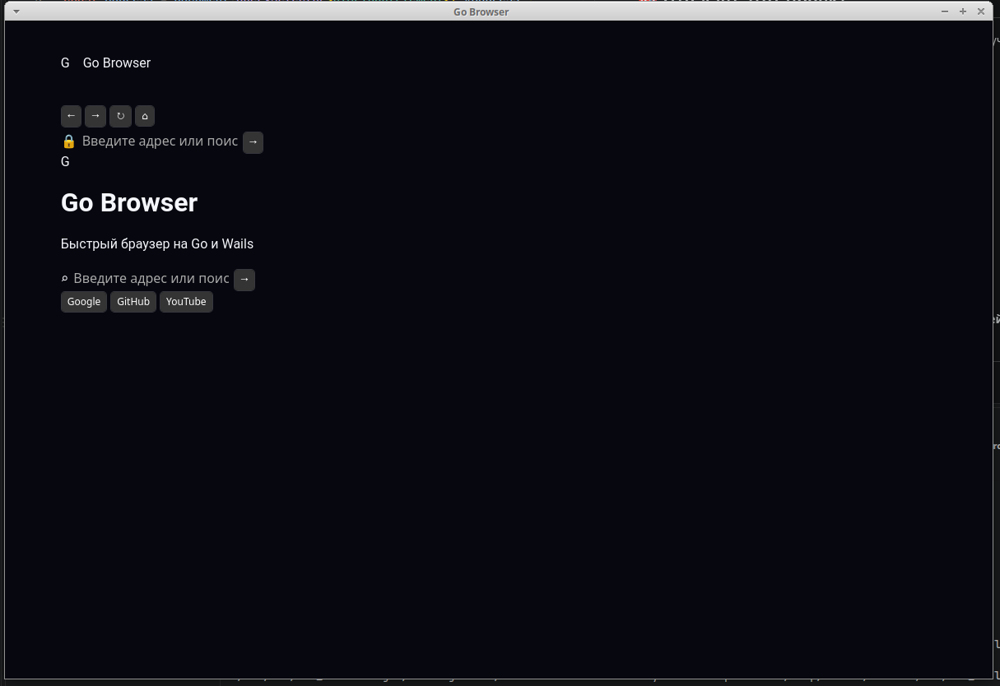

````markdown
# 🌐 Go Browser


# Go Browser — три реализации desktop-приложения на Go

**Go Browser** — учебный и экспериментальный репозиторий, в котором исследуются три различных подхода к созданию desktop-приложений браузерного типа на **Go**.

В репозитории находятся три **отдельных самостоятельных проекта**:

- **Fyne** — нативный графический интерфейс на Go;
- **WebView** — HTML/CSS/JavaScript-интерфейс внутри desktop-приложения;
- **Wails** — Go backend + web frontend на TypeScript, HTML и CSS.

Все три реализации находятся в одном репозитории для удобного изучения и сравнения подходов.

---

# 📁 Структура репозитория

```text
go-browser/
├── fyne/
│   ├── image/
│   │   └── step1.png
│   ├── main.go
│   ├── go.mod
│   ├── go.sum
│   └── README.md
│
├── webview/
│   ├── image/
│   │   ├── first-window.png
│   │   └── second-window.png
│   ├── main.go
│   ├── go.mod
│   ├── go.sum
│   └── README.md
│
├── wails/
│   ├── image/
│   │   └── wails.png
│   ├── README.md
│   └── go-browser-wails/
│       ├── browserservice.go
│       ├── main.go
│       ├── frontend/
│       ├── build/
│       ├── go.mod
│       ├── go.sum
│       └── README.md
│
├── go-browser
└── README.md
````

Каждый из трёх каталогов содержит собственную реализацию и собственный `README.md`.

---

# 🎯 Цель проекта

Основная цель репозитория — показать несколько вариантов построения desktop-приложения на Go на примере одного и того же класса задач.

Общая идея:

```text
                         Go Browser
                              │
              ┌───────────────┼───────────────┐
              │               │               │
              ▼               ▼               ▼
            Fyne           WebView          Wails
              │               │               │
              ▼               ▼               ▼
         Native GUI       Web UI          Web Frontend
              │               │               │
              │               │               ├── TypeScript
              │               │               ├── HTML
              │               │               └── CSS
              │               │
              └───────────────┴───────────────┐
                                              ▼
                                             Go
```

Проект позволяет посмотреть, как одна общая концепция может быть реализована с использованием разных UI-технологий.

---

# 🧩 Реализации

## 🎨 1. Fyne

Каталог проекта:

```text
fyne/
```

**Fyne**-версия использует графические компоненты библиотеки Fyne непосредственно из Go.

Проект демонстрирует работу с:

* desktop-окном;
* `Entry`;
* `Button`;
* `Label`;
* контейнерами;
* layout;
* обработчиками событий;
* Go Modules;
* сборкой desktop-приложения.

На текущем этапе это минимальный экспериментальный прототип браузерного интерфейса.

### 📸 Интерфейс Fyne


### 📖 Подробнее

[Открыть README проекта Fyne →](fyne/README.md)

---

# 🌐 2. WebView

Каталог проекта:

```text
webview/
```

**WebView**-версия использует веб-технологии внутри desktop-окна.

Основная схема:

```text
Go
 │
 ▼
WebView
 │
 ├── HTML
 ├── CSS
 └── JavaScript
```

Проект показывает, как встроить веб-интерфейс в приложение на Go.

Изучаемые технологии:

* Go;
* WebView;
* HTML;
* CSS;
* JavaScript;
* URL;
* `net/url`;
* CGO;
* GTK;
* WebKitGTK;
* desktop-разработка на Linux.

### 📸 Первый интерфейс


### 📸 Второй интерфейс


### 📖 Подробнее

[Открыть README проекта WebView →](webview/README.md)

---

# ⚡ 3. Wails

Каталог проекта:

```text
wails/go-browser-wails/
```

**Wails**-версия построена по модели:

```text
Go Backend
    │
    ▼
  Wails
    │
    ▼
Frontend
├── TypeScript
├── HTML
└── CSS
```

Backend отвечает за основную логику приложения и управление WebView, а frontend отвечает за пользовательский интерфейс.

В текущей реализации присутствуют:

* адресная строка;
* переход по URL;
* поиск;
* автоматическое добавление `https://`;
* проверка URL;
* поддержка HTTP и HTTPS;
* перезагрузка страницы;
* домашняя страница;
* быстрые ссылки;
* индикатор загрузки;
* горячая клавиша `Ctrl + L`;
* горячая клавиша `Ctrl + R`.

Кнопки **Back** и **Forward** присутствуют в интерфейсе, но полноценная навигация по истории пока не реализована.

### 📸 Интерфейс Wails



### 📖 Подробнее

[Открыть README проекта Wails →](wails/go-browser-wails/README.md)

---

# 🖼️ Интерфейсы всех трёх реализаций

Для наглядного сравнения:

## Fyne


## WebView


## Wails


Таким образом, один репозиторий содержит три разных варианта пользовательского интерфейса и архитектуры.

---

# 🔬 Сравнение технологий

| Реализация  | Интерфейс               | Основной подход                   | Backend |
| ----------- | ----------------------- | --------------------------------- | ------- |
| **Fyne**    | Fyne Widgets            | Нативный GUI на Go                | Go      |
| **WebView** | HTML + CSS + JavaScript | Веб-интерфейс внутри desktop-окна | Go      |
| **Wails**   | HTML + CSS + TypeScript | Web frontend + Go backend         | Go      |

## Fyne

```text
Go
└── Fyne
    └── Native GUI
```

## WebView

```text
Go
└── WebView
    └── HTML / CSS / JavaScript
```

## Wails

```text
Go
└── Wails
    ├── Go backend
    └── TypeScript / HTML / CSS frontend
```

---

# 📚 Что можно изучить

Репозиторий можно использовать как практический пример для изучения:

* Go;
* Go Modules;
* desktop-разработки;
* GUI-приложений;
* Fyne;
* WebView;
* Wails;
* HTML;
* CSS;
* JavaScript;
* TypeScript;
* Vite;
* GTK;
* WebKitGTK;
* CGO;
* обработки URL;
* взаимодействия frontend и backend;
* сборки desktop-приложений.

---

# 🖥️ Общая концепция приложения

Несмотря на различие технологий, все проекты строятся вокруг одной общей идеи — небольшого браузерного приложения.

Базовая концепция интерфейса:

```text
┌─────────────────────────────────────────────────────────────┐
│  ←   →   ⟳   🏠      Введите URL или поисковый запрос       │
├─────────────────────────────────────────────────────────────┤
│                                                             │
│                                                             │
│                         Web Browser                         │
│                                                             │
│                     Область веб-контента                    │
│                                                             │
│                                                             │
└─────────────────────────────────────────────────────────────┘
```

Конкретная реализация этой схемы зависит от выбранной технологии.

---

# 🚀 Запуск

Каждый вариант является отдельным Go-проектом.

## Fyne

```bash
cd fyne
go run .
```

Сборка:

```bash
cd fyne
go build -o go-browser-fyne .
```

Подробнее о проекте:

[README Fyne](fyne/README.md)

---

## WebView

```bash
cd webview
go run .
```

Сборка:

```bash
cd webview
go build -o go-browser-webview .
```

Подробнее о проекте:

[README WebView](webview/README.md)

---

## Wails

```bash
cd wails/go-browser-wails
go run .
```

Сборка:

```bash
cd wails/go-browser-wails
go build -o go-browser-wails .
```

Frontend Wails находится в:

```text
wails/go-browser-wails/frontend/
```

Подробнее о проекте:

[README Wails](wails/go-browser-wails/README.md)

---

# 📂 Назначение каталогов

### `fyne/`

Самостоятельный проект на **Fyne**.

```text
fyne/
├── image/
├── main.go
├── go.mod
├── go.sum
└── README.md
```

### `webview/`

Самостоятельный проект на **WebView**.

```text
webview/
├── image/
├── main.go
├── go.mod
├── go.sum
└── README.md
```

### `wails/`

Каталог с реализацией на **Wails**.

```text
wails/
├── image/
├── README.md
└── go-browser-wails/
    ├── main.go
    ├── browserservice.go
    ├── frontend/
    ├── build/
    ├── go.mod
    ├── go.sum
    └── README.md
```

---

# 🧭 Документация проектов

Для каждого варианта предусмотрен собственный README с подробностями реализации.

| Проект      | README                                     | Изображения                                                                                              |
| ----------- | ------------------------------------------ | -------------------------------------------------------------------------------------------------------- |
| **Fyne**    | [README](fyne/README.md)                   | [step1.png](fyne/image/step1.png)                                                                        |
| **WebView** | [README](webview/README.md)                | [first-window.png](webview/image/first-window.png), [second-window.png](webview/image/second-window.png) |
| **Wails**   | [README](wails/go-browser-wails/README.md) | [wails.png](wails/image/wails.png)                                                                       |

---

# 🏗️ Текущее состояние

Проект находится на стадии **учебного и экспериментального прототипирования**.

Главная задача текущего этапа — изучение различных технологий создания desktop-приложений на Go.

Реализации развиваются независимо друг от друга и не являются частями одного приложения.

---

# 🔮 Возможное развитие

Каждый проект можно расширять независимо.

Возможные направления развития:

* вкладки;
* история посещений;
* полноценные `Back / Forward`;
* закладки;
* загрузки файлов;
* контекстное меню;
* DevTools;
* настройки приложения;
* сохранение пользовательских данных;
* улучшенная адресная строка;
* дополнительные элементы браузерного интерфейса;
* работа с несколькими окнами.

---

# 💡 Зачем в репозитории три реализации

Основная идея репозитория — не только создать простой браузерный прототип, но и сравнить различные подходы к созданию desktop-приложений.

```text
                 Один проект
                      │
          ┌───────────┼───────────┐
          │           │           │
          ▼           ▼           ▼
        Fyne       WebView       Wails
          │           │           │
          ▼           ▼           ▼
      Native GUI    Web UI     Web Frontend
          │           │           │
          └───────────┴───────────┘
                      │
                      ▼
                     Go
```

Это позволяет использовать репозиторий как небольшой практический стенд для экспериментов с **Go GUI**, **WebView** и **Wails**.

---

# 📜 Лицензия

Лицензия проекта может быть указана здесь после её выбора.

```text
TODO: добавить лицензию проекта
```

---

# 👤 Автор

**Go Browser** — учебный и экспериментальный проект по разработке desktop-приложений на Go.


