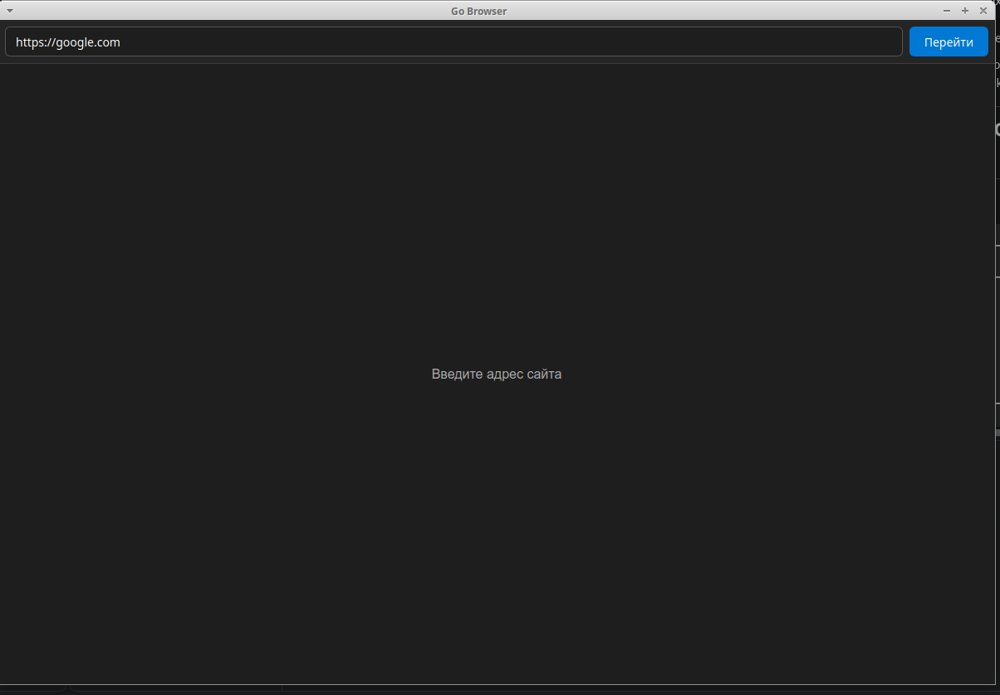
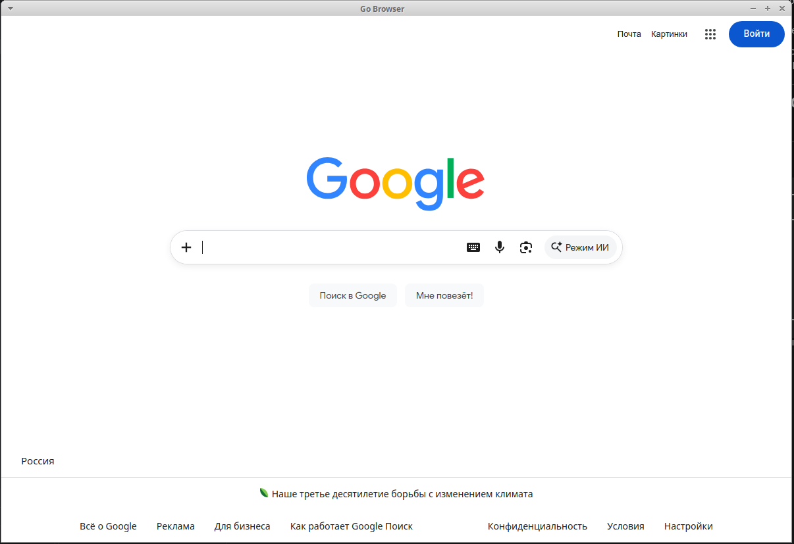

# 🌐 Go Browser — WebView

Минимальный desktop-браузер на **Go**, созданный с использованием **WebView**.

Проект показывает на практике, как встроить веб-интерфейс в desktop-приложение на Go и использовать **HTML, CSS и JavaScript** внутри обычного оконного приложения.

Это учебный проект, который позволяет разобраться в принципах создания desktop-приложений с веб-интерфейсом и сравнить WebView-подход с другими технологиями, представленными в репозитории.

---

## 🎯 Что даёт этот проект

Проект можно использовать как практический пример для изучения:

- создания desktop-приложений на Go;
- интеграции WebView с Go;
- использования HTML внутри desktop-приложения;
- создания интерфейса с HTML и CSS;
- обработки событий через JavaScript;
- работы с URL в Go;
- проверки и нормализации URL;
- использования `net/url`;
- работы с системными зависимостями Linux;
- CGO;
- GTK;
- WebKitGTK;
- сборки desktop-приложений на Linux.

Главная идея проекта — показать, как **обычный веб-интерфейс может использоваться внутри desktop-приложения на Go**.

---

# 🖥️ Что представляет собой приложение

После запуска открывается отдельное desktop-окно с адресной строкой и кнопкой перехода.

Пользователь может:

1. ввести адрес сайта;
2. нажать **«Перейти»**;
3. нажать `Enter`;
4. открыть HTTP или HTTPS-адрес;
5. просматривать страницу внутри WebView.

### Первое окно приложения



### Второе окно приложения



Изображения находятся непосредственно в каталоге проекта:

```text
webview/
├── image/
│   ├── first-window.png
│   └── second-window.png
├── main.go
├── go.mod
├── go.sum
└── README.md